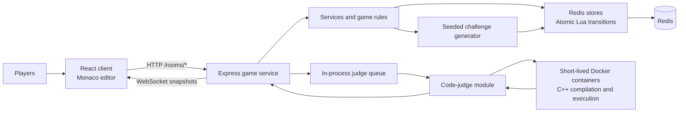
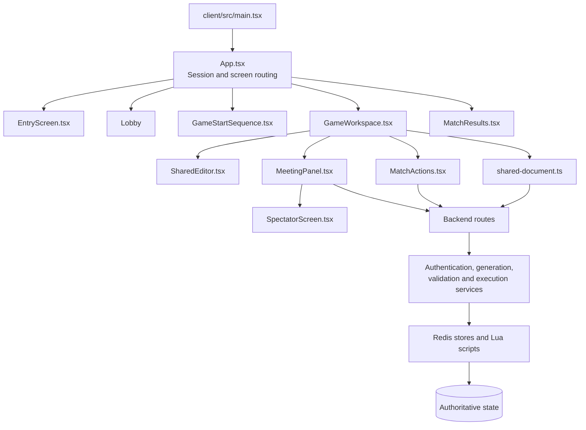
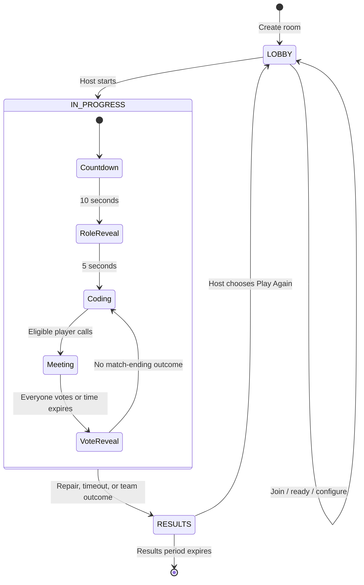
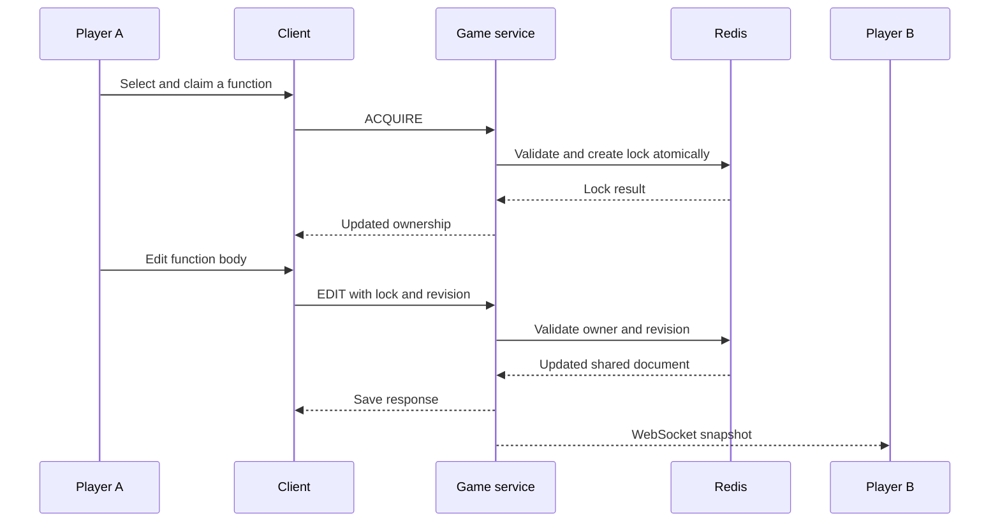
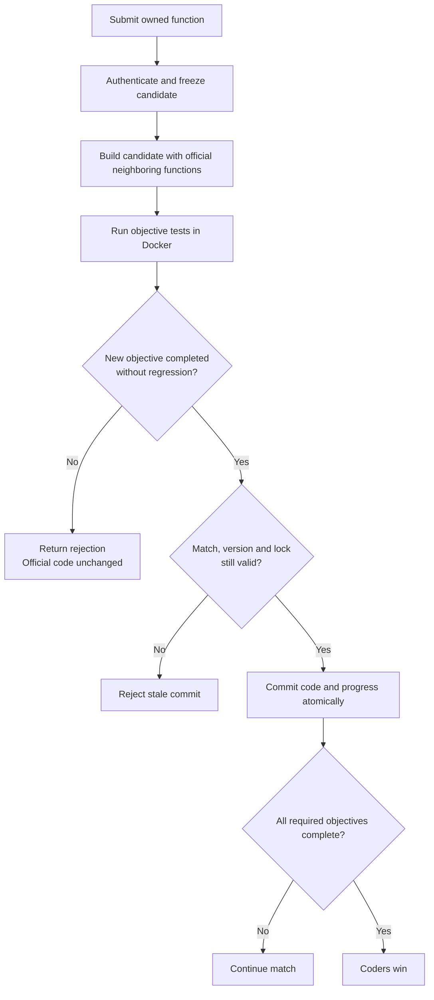
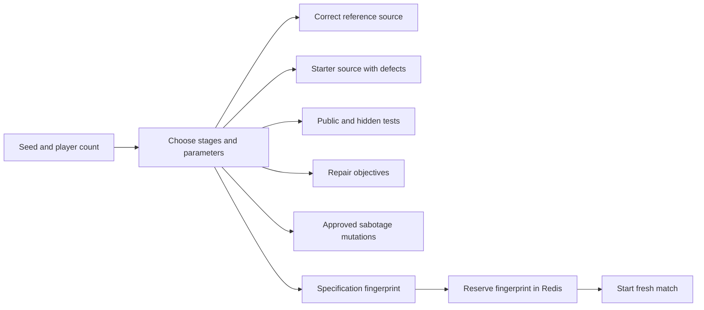

<div align="center">

# 👻 GHOST WRITER

### Good code. Bad company.

A multiplayer coding and social-deduction game where the crew repairs a shared program—and hidden hackers work against them.

**2–8 players · Shared C++ editor · Hidden roles · Sabotage · Emergency meetings**

</div>

---

## Overview

Ghost Writer combines collaborative debugging with the uncertainty of a social-deduction game.

Players enter a room and receive a hidden role. Coders must repair a generated C++ program before time runs out. Hackers blend into the team, use controlled sabotage, and try to keep the program broken.

Everyone sees the same shared document. Function-level locks protect individual work, while a player-activity table shows who is editing each function. When the crew becomes suspicious, they can call a meeting, discuss what happened, and vote.

The server owns the game state, validates actions, evaluates submitted repairs, and decides the outcome.

> **Project status:** An actively developed first version intended for local development and playtesting. This repository is not a claim of production readiness.

## Contents

- [Gameplay](#gameplay)
- [Features](#features)
- [Architecture](#architecture)
- [Match lifecycle](#match-lifecycle)
- [Shared editing and repair flow](#shared-editing-and-repair-flow)
- [Challenge generation](#challenge-generation)
- [Sabotage](#sabotage)
- [Meetings and voting](#meetings-and-voting)
- [Code execution](#code-execution)
- [Sessions and reconnection](#sessions-and-reconnection)
- [Repository structure](#repository-structure)
- [Running locally](#running-locally)
- [Configuration](#configuration)
- [API overview](#api-overview)
- [Development commands](#development-commands)
- [Troubleshooting](#troubleshooting)
- [Current limitations](#current-limitations)
- [Roadmap](#roadmap)

---

## Gameplay

### Roles

| Role | Objective | Main actions |
|---|---|---|
| **Coder** | Complete every required repair objective before time expires | Claim functions, edit shared code, run public tests, submit repairs, discuss, and vote |
| **Hacker** | Prevent the crew from finishing, or reach the applicable team-population win condition | Blend into shared editing, use token-based sabotage, discuss, and vote |
| **Spectator** | Observe the rest of the match after elimination | Watch the shared document and match state without participating in active gameplay |

Roles are assigned by the server. A player's name or position in the lobby does not determine their role.

### Team sizes

| Players at match start | Hackers | Sabotage-token pool |
|---|---:|---:|
| 2–5 | 1 | 3 |
| 6–8 | Host chooses 1 or 2 | 3 with one hacker; 5 shared between two hackers |

The two-hacker option becomes available when the room has at least six players.

### Winning

**Coders win when:**

- All required repair objectives are completed.
- No active hackers remain, where population-based victory applies.

**Hackers win when:**

- The coding timer expires before all required objectives are completed.
- Active coders are fewer than or equal to active hackers, where population-based victory applies.

**Two-player exception**

A match that starts with two players contains one coder and one hacker:

- Emergency meetings and voting are disabled.
- The ordinary population-parity rule is disabled.
- The normal challenge outcomes are completion of all repairs or expiry of the coding timer.
- Departure and room-cleanup handling are separate lifecycle cases.

### Starting a match

1. Create a room or join using its six-character code.
2. Choose a unique player name within the room.
3. Guests mark themselves ready.
4. The host starts when the room is eligible.
5. A **10-second countdown** runs.
6. A **5-second role-reveal sequence** introduces the player's role.
7. The workspace opens automatically.

Players do not need to press an additional button after the countdown to enter the workspace. Fullscreen can be entered or exited during play.

---

## Features

### Multiplayer rooms

- Room creation and joining through short room codes.
- Host-controlled match start and hacker-count settings.
- Guest readiness checks.
- Duplicate-name protection within a room.
- Session-based player identity.
- Retry-safe joining.

### Shared coding workspace

- Monaco-powered C++ editor.
- One shared document per match.
- Function ownership and revision checks.
- Protection for function signatures and other fixed program structure.
- Player activity showing which function each player owns.
- Public test execution.
- Server-verified repair submission.
- Local draft-recovery support.
- Light and dark themes.

### Social deduction

- Hidden coder and hacker roles.
- Controlled sabotage with tokens and cooldowns.
- Private communication for a two-hacker team.
- Emergency meetings with discussion and voting together.
- Visible vote results.
- Eliminated-player spectator mode.

### Match lifecycle

- Server-controlled countdowns and deadlines.
- Reconnection support without requiring mouse activity.
- Judge-availability monitoring.
- Coding-time adjustments during meetings and judge outages.
- A 60-second results period.
- Host-controlled replay preparation.

---

## Architecture

Ghost Writer currently runs as a React frontend, one Node.js game-service process, Redis, and short-lived Docker containers used by the code judge.

The `workers/code-judge` directory contains the execution module. It is invoked by the game service; it is not currently a separately deployed queue-consuming service.



### Technology stack

| Layer | Technology | Responsibility |
|---|---|---|
| Interface | React, TypeScript, Vite | Entry, lobby, gameplay, meetings, spectator view, results |
| Editor | Monaco Editor | C++ editing and editor interaction |
| HTTP API | Express | Validated game actions and authenticated reads |
| Realtime delivery | `ws` WebSockets | Shared-document snapshots and connection health |
| State | Redis | Rooms, identities, roles, documents, meetings, and deadlines |
| Atomic transitions | Redis Lua scripts | Coordinated state changes without partial updates |
| Challenge system | Seeded TypeScript generator | Program assembly, reference code, tests, and objectives |
| Execution | Docker and GCC | Resource-limited C++17 compilation and execution |

### Codebase flow



**Responsibility boundaries**

- **Components** render screens and collect player actions.
- **Client synchronization code** coordinates document updates, reconnection, and recovery.
- **Routes** validate requests and select the appropriate operation.
- **Services** implement authentication, generation, execution, and orchestration.
- **Stores and Lua scripts** enforce state-dependent rules when reading or committing changes.
- **The judge** returns execution results; it does not independently decide room membership or victory.

---

## Match lifecycle

The main stored room phases are `LOBBY`, `IN_PROGRESS`, and `RESULTS`.

Countdown, role reveal, coding, and meetings are substates controlled by timestamps and match metadata.



The default coding duration is **30 minutes**. Meetings and applicable judge outages pause coding time through server-side deadline adjustments.

After a match finishes, the results screen remains available for **60 seconds**. It shows the outcome and match statistics while the host can prepare another match.

---

## Shared editing and repair flow

### Shared draft versus accepted code

The application distinguishes between:

- **Shared draft:** the code currently visible while players edit.
- **Official code:** the version accepted by the server through a repair or sabotage commit.

This lets players see each other's work without treating every keystroke as a completed repair.

### Function locks

A player claims a function before editing it.

The server checks ownership, lock identity, match identity, and revision information. Another player cannot simply overwrite an owned function.

The editable unit is the function body. Includes, signatures, outer braces, and other protected structure remain outside ordinary editing permissions.

This is a lock-and-revision collaboration model, not a CRDT or operational-transformation implementation.

### Synchronization

Edits are submitted through HTTP document actions.

The server sends shared-document snapshots over WebSockets. The current implementation checks Redis approximately every **250 ms per authenticated connection** and sends a snapshot when its serialized content differs from the previous one.



### Submitting a repair

1. The coder submits their owned function.
2. Shared-document middleware freezes the function for checking.
3. The server constructs a candidate using that function and the official versions of other functions.
4. The judge evaluates the candidate against public and hidden objective tests.
5. The server rejects regressions and submissions without new objective progress.
6. A successful atomic commit updates the official code, source hash, version, and completed objectives.
7. The accepted function is released.



> Public tests are useful debugging feedback. Passing them alone does not prove that a repair objective is complete.

The current implementation evaluates objective tests against the candidate program. It does **not** perform exact source-code matching, and it does **not** yet isolate every submitted function inside an otherwise-correct reference program.

---

## Challenge generation

Matches use a seeded procedural generator instead of selecting only from a small set of fixed programs.

The generator assembles connected numeric-processing pipelines with varying operations, parameters, ordering, and intentional defects.

Examples of generated stages include:

- Discounts.
- Scaling with integer rounding.
- Charges per block.
- Upper and lower limits.
- Group-based bonuses.

| Room size | Generated pipelines |
|---|---:|
| 2–4 players | 4 |
| 5–8 players | 5 |

Each pipeline contains three stage functions and a processing function. Shared input handling and a program entry point connect the generated program.



### Reproducibility and variety

- A seed reproduces the underlying generated specification.
- A match receives its own identity.
- The server reserves specification fingerprints in Redis to avoid reusing an already-reserved specification.
- Generation retries if a fingerprint has already been reserved.

The no-repeat record lasts as long as the corresponding Redis data is retained. This is procedural variation, not unlimited AI-generated source code.

### Public and private challenge data

| Sent to players | Kept server-side |
|---|---|
| Starter/official source | Correct reference source |
| Public examples | Hidden tests |
| Objective descriptions | Generation seed and internal specification metadata |
| Code version and source hash | Sabotage-validation metadata |
| Completed-objective IDs | Private match state |

The repository also includes earlier static and template-based challenges used by validation and development tools. The active match-start path uses the procedural generator.

---

## Sabotage

The current hacker controls expose **server-approved mutations**.

A sabotage request is validated against the active match, current code version, player role, token balance, cooldown, and function state. The server evaluates the mutation before committing it.

| Target | Cost | Cooldown |
|---|---:|---:|
| Ordinary eligible target | 1 token | 120 seconds |
| Previously repaired target | 2 tokens | 180 seconds |

For two hackers, the token balance and sabotage cooldown are shared.

Requests use identifiers and stored receipts so an accepted request can be retried without intentionally applying the same charge twice.

### Hacker editing versus sabotage

Hackers can participate in the shared editor, but cannot submit coder repairs.

Releasing a hacker-owned function restores its lock-time contents. Persistent official sabotage goes through the separate token-based controls.

A free-form operator-editing sabotage system is **not part of the current implementation**.

---

## Meetings and voting

An eligible player can call an emergency meeting during coding.

- Discussion and voting share the same **180-second window**.
- There is no separate voting-only period.
- Coding actions are paused during the meeting.
- Voting closes when every eligible player has voted or the deadline is reached.
- An **8-second reveal** shows the ballots and outcome.
- Each player can call at most one meeting per match.
- A match allows at most three meetings.
- Two-player matches do not use meetings.

### Elimination rule

Only votes cast for actual eligible players count toward elimination.

- A player cannot vote for themselves.
- Skips count as submitted ballots, but add no vote to any candidate.
- Missing votes add no vote to any candidate.
- The unique player with the highest positive total is eliminated.
- A tie eliminates nobody.
- If no player receives a vote, nobody is eliminated.

This is **plurality voting**, not an absolute-majority requirement.

**Example:** five skips and one vote for Player A result in Player A having the unique highest player-vote total.

Eliminated players remain as spectators instead of being removed from the experience immediately.

---

## Code execution

Submitted C++ is compiled and executed through the Docker-based judge.

The image is built from GCC 14 and uses a dedicated non-root user. The judge launches short-lived containers with execution restrictions.

| Setting | Current value |
|---|---|
| C++ standard | C++17 |
| Container user | UID/GID `10001` |
| Network | Disabled |
| CPU limit | 1 CPU |
| Memory limit | 256 MiB |
| PID limit | 64 |
| Root filesystem | Read-only |
| Linux capabilities | Dropped |
| Privilege escalation | `no-new-privileges` |
| Maximum source size | 64 KiB |
| Maximum tests per judge invocation | 10 |
| Maximum input / expected output per test | 8 KiB each |
| Execution output capture limit | 64 KiB |
| Compilation command timeout | 12 seconds |
| Program execution timeout | 2 seconds per test |

Outer process deadlines also cover Docker startup and command overhead.

These restrictions reduce exposure when executing untrusted programs. They are not a substitute for a production security review or stronger isolation appropriate to a public service.

### Judge scheduling

The game service currently maintains an in-memory queue:

- One active judge job.
- Up to 12 waiting jobs.
- A 90-second queue-wait limit.
- Player-visible queue status.

The queue is local to one Node.js process. It is not distributed through Redis.

### Judge outages

The server runs a trusted health probe to distinguish judge availability problems from a player's incorrect program.

When the judge becomes unavailable, validation is paused and applicable coding deadlines and cooldowns are adjusted. A player's compile error or wrong answer alone is not treated as an infrastructure outage.

---

## Sessions and reconnection

Ghost Writer uses room-scoped session authentication rather than registered user accounts.

- Session tokens are 32 random bytes represented as hexadecimal strings.
- The server stores SHA-256 token fingerprints.
- Protected HTTP actions use `Authorization: Bearer <token>`.
- WebSocket authentication happens in the initial connection message.
- Session and recovery information is maintained in browser storage.

WebSocket ping/pong checks help preserve presence even when a tab is in the background. Presence does not depend on moving the mouse or typing.

The reconnection grace period is **five minutes after the last successful presence update**. An actual disconnection can therefore expire, even if the tab remains open.

Room deadlines and related Redis-key expiry are coordinated with match transitions.

---

## Repository structure

```text
Ghost-Writer/
├── client/
│   ├── src/
│   │   ├── App.tsx                  # Session and screen coordination
│   │   ├── EntryScreen.tsx          # Create/join interface
│   │   ├── GameArtwork.tsx          # Illustrated game artwork
│   │   ├── GameStartSequence.tsx    # Countdown and role reveal
│   │   ├── GameWorkspace.tsx        # Main gameplay workspace
│   │   ├── SharedEditor.tsx         # Monaco and edit boundaries
│   │   ├── shared-document.ts      # Document sync and recovery
│   │   ├── DraftRecovery.tsx        # Recover unsent work
│   │   ├── MatchActions.tsx         # Sabotage controls
│   │   ├── MeetingPanel.tsx         # Discussion and voting
│   │   ├── SpectatorScreen.tsx      # Eliminated-player experience
│   │   ├── HackerSettings.tsx       # Host hacker-count controls
│   │   ├── HackerChat.tsx           # Private hacker chat
│   │   ├── MatchResults.tsx         # Results and replay
│   │   ├── JudgeQueueStatus.tsx     # Validation queue feedback
│   │   ├── JudgeOutageBanner.tsx    # Judge availability feedback
│   │   ├── monaco-setup.ts          # Editor setup and themes
│   │   ├── GameTheme.css           # Shared layouts and styling
│   │   └── GameColors.css          # Color and presentation layer
│   ├── tests/
│   └── vite.config.ts              # HTTP and WebSocket proxy
│
├── services/
│   └── game-service/
│       ├── src/
│       │   ├── index.ts            # Server startup and router order
│       │   ├── real-time.ts        # WebSocket snapshots and heartbeat
│       │   ├── config/             # Redis connection
│       │   ├── routes/             # HTTP action handlers
│       │   ├── services/           # Rules, generation, judge scheduling
│       │   ├── stores/             # Redis operations and Lua scripts
│       │   └── types/              # Shared server-side types
│       ├── scripts/
│       └── tests/
│
├── workers/
│   └── code-judge/
│       ├── Dockerfile              # GCC execution image
│       ├── judge.mjs               # Compile/run orchestration
│       ├── judge.d.mts              # Type declarations
│       ├── smoke-test.mjs
│       └── api-smoke-test.mjs
│
├── challenges/
│   ├── templates/                  # Template challenge assets
│   └── billing-001/                # Earlier challenge fixture
│
├── infra/
│   └── compose.yaml               # Redis service and persistent volume
│
├── docs/
├── package.json                   # Root test commands
└── README.md
```

### Where to start reading

1. `client/src/App.tsx` — how users move between screens.
2. `services/game-service/src/index.ts` — how the server is assembled.
3. `services/game-service/src/services/room-service.ts` — room creation and match preparation.
4. `services/game-service/src/services/procedural-generator.ts` — challenge construction.
5. `client/src/shared-document.ts` and `SharedEditor.tsx` — collaborative editing.
6. `services/game-service/src/stores/shared-document-store.ts` — authoritative document actions.
7. `services/game-service/src/routes/submit-routes.ts` — repair evaluation.
8. `services/game-service/src/stores/voting-lua.ts` — vote settlement.
9. `workers/code-judge/judge.mjs` — execution isolation.

Router ordering matters. Queue handling, meeting restrictions, and shared-document submission preparation run before the final execution or repair handlers.

---

## Running locally

### Prerequisites

- Node.js **22.12 or newer**.
- npm.
- Git.
- Docker with Linux containers available.
- Docker Compose.

On Windows, start Docker Desktop and wait for its Linux engine to become ready.

A native C++ compiler and a separate native Redis installation are not required for the Docker-based setup.

### 1. Clone the repository

```bash
git clone https://github.com/VaibhavDGP/Ghost-Writer.git
cd Ghost-Writer
```

Run the following commands from the repository root unless stated otherwise.

### 2. Install dependencies

```bash
npm --prefix client ci
npm --prefix services/game-service ci
```

The client and backend have separate dependency installations. Installing only at the repository root does not install both applications.

### 3. Start Redis

```bash
docker compose -f infra/compose.yaml up -d redis
```

The supplied Compose configuration:

- Uses `redis:8-alpine`.
- Publishes Redis on `127.0.0.1:6379`.
- Enables append-only persistence.
- Stores Redis data in a named volume.

Optional connectivity check:

```bash
docker compose -f infra/compose.yaml exec redis redis-cli ping
```

Expected response:

```text
PONG
```

### 4. Build the judge image

```bash
docker build -t ghost-writer-judge:local workers/code-judge
```

The tag must match the image name expected by `judge.mjs`.

You do not need to start a permanent judge container. The game service launches execution containers when needed.

### 5. Start the backend

In one terminal:

```bash
npm --prefix services/game-service run dev
```

Wait for:

```text
Connected to Redis
Game Service running at http://localhost:3001
```

The backend also establishes judge health during startup.

### 6. Start the frontend

In another terminal:

```bash
npm --prefix client run dev
```

Open the **Local URL printed by Vite**, normally:

```text
http://localhost:5173
```

Keep both terminals running.

### Local service map

| Service | Default address |
|---|---|
| Frontend | `http://localhost:5173` |
| Game API | `http://localhost:3001` |
| Health endpoint | `http://localhost:3001/health` |
| Redis | `127.0.0.1:6379` |
| WebSocket path | `/rooms/live`, forwarded through Vite |

Vite proxies `/rooms` requests, including WebSocket upgrades, to `http://127.0.0.1:3001`.

### Playing locally

1. Create a room in one browser session.
2. Join from another independent session using a different player name.
3. Mark guests ready.
4. Start from the host session.

For reliable multi-player simulation, use separate browser profiles or independent private sessions. Duplicating a tab can copy session-storage state and make two tabs represent the same player.

### Stopping

Stop the frontend and backend with `Ctrl+C`.

Stop Redis without deleting its stored data:

```bash
docker compose -f infra/compose.yaml stop redis
```

---

## Configuration

| Setting | Default | Description |
|---|---|---|
| `REDIS_URL` | `redis://127.0.0.1:6379` | Redis connection URL |
| `MATCH_DURATION_SECONDS` | `1800` | Coding duration; integer from 10 to 7200 |
| Backend port | `3001` | Currently set in server source |
| Judge image | `ghost-writer-judge:local` | Currently set in the judge module |

The current startup code reads process environment variables. It does not automatically load a `.env` file.

### Bash / Git Bash

```bash
export MATCH_DURATION_SECONDS=120
npm --prefix services/game-service run dev
```

Restore the default:

```bash
unset MATCH_DURATION_SECONDS
```

### PowerShell

```powershell
$env:MATCH_DURATION_SECONDS = "120"
npm --prefix services/game-service run dev
```

Restore the default:

```powershell
Remove-Item Env:MATCH_DURATION_SECONDS
```

Restart the backend after changing environment variables.

---

## API overview

Paths below are relative to the game-service origin. Protected operations require a valid player session; permissions also depend on role, phase, ownership, and match state.

| Method | Path | Purpose |
|---|---|---|
| GET | `/health` | Basic service response |
| POST | `/rooms` | Create a room |
| GET | `/rooms/:code` | Read room state |
| POST | `/rooms/:code/join` | Join a room |
| GET | `/rooms/:code/me` | Resolve player identity |
| GET | `/rooms/:code/me/role` | Retrieve an eligible player's role |
| PATCH | `/rooms/:code/ready` | Change guest readiness |
| POST | `/rooms/:code/start` | Start an eligible room |
| DELETE | `/rooms/:code/players/me` | Leave the room |
| POST | `/rooms/:code/presence` | Refresh presence |
| GET | `/rooms/:code/clock` | Read timed match state |
| GET | `/rooms/:code/document` | Read shared-document state |
| POST | `/rooms/:code/document` | `ACQUIRE`, `EDIT`, or `RELEASE` |
| POST | `/rooms/:code/run` | Execute public tests |
| POST | `/rooms/:code/submit` | Submit an owned function for repair verification |
| GET | `/rooms/:code/sabotage` | Read available sabotage state |
| POST | `/rooms/:code/sabotage` | Request a controlled mutation |
| GET | `/rooms/:code/meeting` | Read meeting state |
| POST | `/rooms/:code/meeting` | `CALL`, `CHAT`, or `VOTE` |
| GET / PATCH | `/rooms/:code/hacker-settings` | Read/change hacker count |
| GET / POST | `/rooms/:code/hacker-chat` | Private hacker communication |
| GET | `/rooms/:code/judge-status` | Read validation queue status |
| POST | `/rooms/:code/replay` | Prepare another match |
| WebSocket | `/rooms/live` | Authenticated document snapshots |

Request bodies are validated by the corresponding route modules. This table is a navigation guide, not a complete versioned API specification.

---

## Development commands

### Tests

```bash
npm test
```

This runs client tests followed by the game-service suite.

The backend suite includes API tests that expect a running local game service. Start Redis, build the judge image, and run the backend before executing the full suite. Use a development environment rather than an active shared game session.

### Focused generator tests

```bash
npm run test:unit
```

The root `test:unit` script currently runs the backend challenge-generator test file; it is not the entire backend suite.

### Type checking

```bash
npm --prefix services/game-service run typecheck
```

### Client production build

```bash
npm --prefix client run build
```

### Backend compilation

```bash
npm --prefix services/game-service run build
```

### Client linting

```bash
npm --prefix client run lint
```

### Direct judge smoke test

Requires Docker and the built judge image:

```bash
node workers/code-judge/smoke-test.mjs
```

Test commands are documented for contributors. This README does not imply that every command passes on every revision or that a production deployment has been validated.

---

## Troubleshooting

### Redis connection refused

An error such as:

```text
connect ECONNREFUSED 127.0.0.1:6379
```

means the backend cannot reach Redis at its configured address.

Start Redis:

```bash
docker compose -f infra/compose.yaml up -d redis
```

Then check the Compose service status and confirm `REDIS_URL` matches the published port.

### Port 6379 is already occupied

Inspect running containers before starting another Redis instance:

```bash
docker ps --format "table {{.Names}}\t{{.Ports}}"
docker compose -f infra/compose.yaml ps
```

If an existing Redis service is already the intended instance, use it rather than creating a duplicate.

If changing the published host port, update both the Compose mapping and `REDIS_URL`. Do not stop unrelated containers or delete volumes merely to free the port.

### Docker or judge unavailable

Confirm:

- Docker is running with Linux containers.
- The backend can invoke the Docker CLI.
- `ghost-writer-judge:local` has been built.
- Docker can mount the temporary directories used by the judge.

The UI may show validation paused while the trusted health probe cannot execute.

### `Unexpected token '<' ... is not valid JSON`

An API request received HTML instead of JSON.

- Open the Vite URL printed by the frontend terminal.
- Confirm the backend is running on port 3001.
- Confirm the `/rooms` proxy in `client/vite.config.ts`.
- Inspect the failing Network request's status and response body.

The HTML response may come from an incorrect frontend route, an unrecognized backend route, or a server error. The parsing message alone does not identify the cause.

### The room has no valid generated challenge

An existing room may contain stale or incompatible match data after development changes.

Create a fresh room and inspect the backend's startup or generation errors. Avoid clearing all Redis data as the first troubleshooting step.

### A repair passes public tests but is rejected

Public tests do not cover every required case.

A repair can also be rejected because it:

- Fails hidden objective tests.
- Regresses an already-completed objective.
- Adds no new objective progress.
- Uses stale code or lock information.
- Is submitted after a relevant match-state change.

### A player cannot edit

Confirm that:

- The player owns the selected function.
- The document connection is synchronized.
- No meeting or applicable judge pause is active.
- The function is not being checked.
- The player is not a spectator.
- The match is still in its coding phase.

### Another tab behaves like the same player

Browser session storage may have been copied when the tab was duplicated. Use an independent browser profile or private session for each simulated player.

---

## Current limitations

- **Single-process scheduling:** the judge queue is in memory and is not coordinated across multiple game-service instances.
- **Snapshot-based realtime delivery:** each authenticated socket polls Redis; this is not a Redis Pub/Sub fan-out implementation.
- **Controlled sabotage only:** arbitrary operator-editing sabotage is not implemented.
- **Objective-based verification:** independent function verification against correct reference neighbors remains future work.
- **Finite procedural generator:** programs vary within the generator's supported operations and parameter space.
- **Session identity only:** there is no registered-account system, ranked matchmaking, or persistent player profile.
- **Deployment requires additional work:** production TLS, reverse-proxy configuration, distributed scheduling, operational monitoring, and execution-isolation review are not supplied as a complete deployment platform.
- **Docker dependency:** judged code execution requires access to a working Linux Docker engine.

---

## Roadmap

Potential next steps, not claims of completed functionality:

- [ ] Controlled operator-editing sabotage.
- [ ] Independent function verification using trusted reference implementations.
- [ ] Broader generated challenge families.
- [ ] Automated end-to-end multiplayer scenarios.
- [ ] Accessibility and responsive-interface review.
- [ ] Redis Pub/Sub or another scalable snapshot-distribution mechanism.
- [ ] Distributed judge scheduling and dedicated execution workers.
- [ ] Production deployment configuration and operational metrics.
- [ ] Further hardening of untrusted-code execution.

---

## Contributing

When changing gameplay behavior:

1. Identify the owning route, service, and Redis store.
2. Enforce permissions and state rules on the server.
3. Preserve atomicity for changes that update related state.
4. Consider retries, stale versions, disconnects, and concurrent requests.
5. Update relevant tests and documentation.
6. Keep hidden tests, reference answers, and private role information out of public responses.

When changing presentation:

- Keep shared colors and component styles consistent.
- Preserve keyboard navigation and visible focus.
- Keep the coding workspace readable.
- Do not rely on color alone to communicate game state.
- Respect reduced-motion preferences.

---

<div align="center">

**Repair the program. Read the room.**

*No one debugs alone.*

</div>